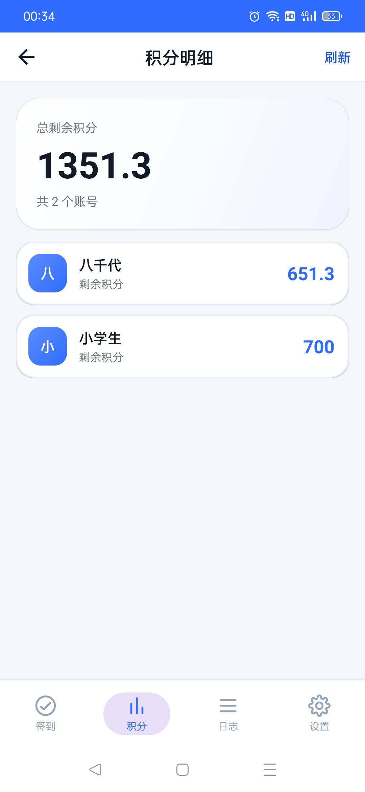
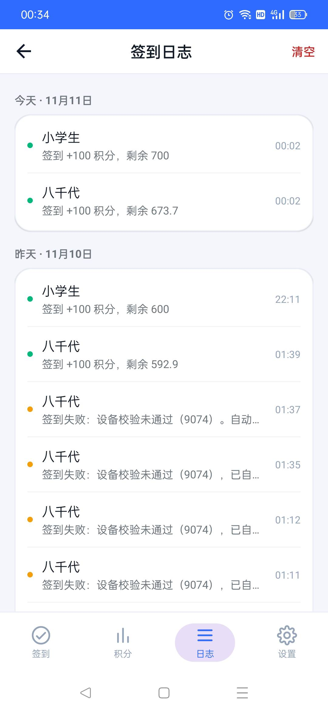
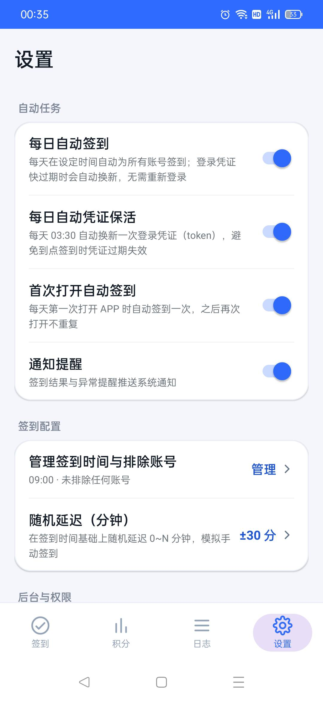
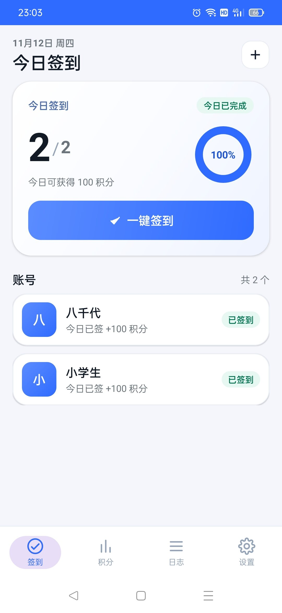
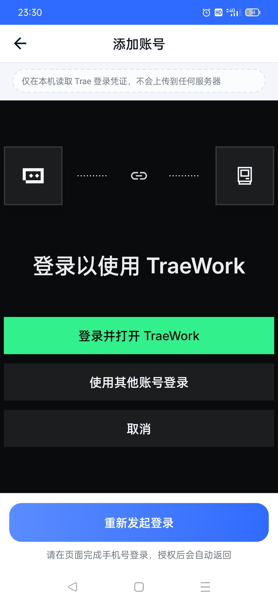

# TraeCheckin

[简体中文](README.md) · English

> Daily check-in for Trae on Android: account login, one-tap check-in, credits, logs and scheduled check-in.
> Native Android, no third-party dependencies, credentials stay on the device.


> **Disclaimer**
>
> This is an independent third-party tool, **not affiliated with or authorized by ByteDance / Trae**.
> It is for learning and research only; use it at your own risk and follow Trae's terms of service.
> A large part of the code references
> [`Luckyboy-daidai/wb-checkin-android`](https://github.com/Luckyboy-daidai/wb-checkin-android) (MIT).
> Most code was written by AI (hy4 and DeepSeek V4.1 Flash); see [`AI-USAGE.md`](AI-USAGE.md).
> The project is provided "as is", without any warranty.

<p align="center">
  
  
  
  
</p>

<p align="center"><sub>Real-device screenshots (1080×2340). Account names and credits are demo data.</sub></p>

## Download

**Latest: v2.4.3, ready to install.**

- [**Download TraeCheckin-2.4.3.apk**](https://github.com/Liqevu324/trae-checkin-android/releases/latest)
- Android 7.0+ (minSdk 24).
- Direct upgrade from v2.2.0 / 2.3.0 / 2.4.0 / 2.4.1 / 2.4.2: the six APKs share the same signing key.
  Accounts, check-in history, manually set device IDs and settings are preserved.
- APKs built from source use a different signature; uninstall the old app first (this clears local data).
- SHA256: `849abc9e8873006ce008ce70fd42a9c713da69dc108d6dbdac824dde6622323a`
- Signing certificate SHA256: `6f53acbfb3dc6723db5239232a1b039d003e30387727844956c6061882b824b3`
- All versions: [Releases](https://github.com/Liqevu324/trae-checkin-android/releases);
  checksums and install order: [`docs/APK-ARCHIVE.md`](docs/APK-ARCHIVE.md).

## Features

- **Add account**: official Trae SOLO OAuth in a WebView; credentials are read on-device, no PC or manual token copy
- **One-tap check-in**: check in all accounts concurrently with live progress
- **Multi-account**: per-account menu (check in now / view credits / delete), long-press to delete
- **Credits**: aggregated remaining credits, per-account breakdown, manual refresh
- **Logs**: grouped by day; failed attempts are recorded with server reasons; long-press to copy the full error (no credentials)
- **Scheduled check-in**: `AlarmManager` + notification, restored after reboot
- **Network resilience (v2.4.3)**: network preflight, retries for DNS/connect/timeout, automatic re-check-in at 15 / 30 / 60 minutes (up to 3 times), `goAsync()` + 20-minute wake lock, fixed `thread interrupted`
- **Credential keep-alive**: refreshes the login credential daily at 03:30
- **Check-in settings**: custom time, random delay, exclude accounts from automatic check-in
- **Import / export**: JSON account migration, append-only and deduplicated; credential warning before export
- **Built-in docs**: user guide, privacy policy, terms/disclaimer, open-source licenses
- **About**: developer, version, MIT license and disclaimer
- **Native UI**: system widgets + XML only, no androidx / Material / third-party libraries

## Add an account

1. Open the app and tap **“+”** at the top right of the “Today” page.
2. Sign in with your phone number and verification code on the official authorization page.
   The login detector may respond slowly; wait a little or switch to a more stable network (e.g. mobile data).
3. When the **“登录以使用 TraeWork”** page appears, tap the green **“登录并打开 TraeWork”** button.
4. The app captures the callback, reads the credential and adds the account. The first check-in runs automatically.

> Do not tap “使用其他账号登录” or “取消”. If you tap them by mistake, start the login again.

| Step 1: tap “+” | Step 3: tap “登录并打开 TraeWork” |
|---|---|
|  |  |
| <sub>Start from the “Today” page.</sub> | <sub>Tap the green button; do not tap “取消”.</sub> |

If you still get `9074`, open the account menu → “设置设备号” and set a 12–20 digit numeric device ID.
See the [troubleshooting guide](docs/TROUBLESHOOTING.md) (Chinese) for details.

## Permissions

| Permission | Purpose |
|---|---|
| `INTERNET` | Access `api.trae.cn` / `www.trae.cn` |
| `ACCESS_NETWORK_STATE` | Check whether the network is available before check-in (read-only) |
| `POST_NOTIFICATIONS` (Android 13+) | Check-in result notifications |
| `RECEIVE_BOOT_COMPLETED` | Restore scheduled alarms after reboot |
| `SCHEDULE_EXACT_ALARM` / `USE_EXACT_ALARM` | Exact scheduled check-in |
| `REQUEST_IGNORE_BATTERY_OPTIMIZATIONS` | Guide the user to the battery whitelist |
| `WAKE_LOCK` | Keep the device awake during check-in |

On some Chinese ROMs (ColorOS / OriginOS / HyperOS / EMUI), also allow autostart and background running.
See [`docs/COMPATIBILITY.md`](docs/COMPATIBILITY.md) (Chinese) for generic paths.

## Build

Requirements: JDK 17+, Android SDK with `build-tools;34.0.0` and `platforms;android-34`.

```bash
ANDROID_SDK=/path/to/android-sdk bash build.sh
```

The project uses a small, Gradle-free build chain:
`aapt2 compile/link → javac --release 8 → d8 → zip classes.dex → zipalign → apksigner`.
Signing credentials are read from `SIGNING_KEYSTORE` / `SIGNING_STORE_PASS` / `SIGNING_KEY_PASS`;
without them, the script creates a one-off debug key that must not be distributed.

## Documentation

The detailed documentation is currently in Chinese:

- [Troubleshooting](docs/TROUBLESHOOTING.md): 9074 / 9095 / 1001 / 9004, login, WebView, network, notifications, scheduling
- [Migration & backup](docs/MIGRATION.md): export/import, changing phones, device ID, uninstall warnings
- [Compatibility](docs/COMPATIBILITY.md): Android versions, Chinese ROM background settings, WebView
- [APK archive & checksums](docs/APK-ARCHIVE.md): v2.2.0 → v2.4.3 SHA256, signature, install order
- [Architecture](ARCHITECTURE.md), [privacy](PRIVACY.md), [security](SECURITY.md),
  [third-party notices](THIRD-PARTY-NOTICES.md), [changelog](CHANGELOG.md)

## Related projects

| Project | Form | Difference |
|---|---|---|
| [Luckyboy-daidai/wb-checkin-android](https://github.com/Luckyboy-daidai/wb-checkin-android) | Android / WorkBuddy | Reference project; this project independently implements SOLO OAuth, device-ID/9074 handling and automatic re-check-in |
| [ggzhzc/workbuddy-trae-checkin](https://github.com/ggzhzc/workbuddy-trae-checkin) | Cloudflare Worker | Cloud-hosted, no app installation required |
| [Maquer/trae-signin](https://github.com/Maquer/trae-signin) | GitHub Actions / CLI | Script + scheduled workflow for desktop/server |
| [xiaoyinge/trae-signin-gui](https://github.com/xiaoyinge/trae-signin-gui) | Windows desktop | Tauri 2 + Rust single executable |

> This list is for reference only and is not an endorsement. Evaluate each project's license, security and compliance yourself.

## License

[MIT](LICENSE) © 2026 辉夜彩叶一休尼、我是八千代的狗
