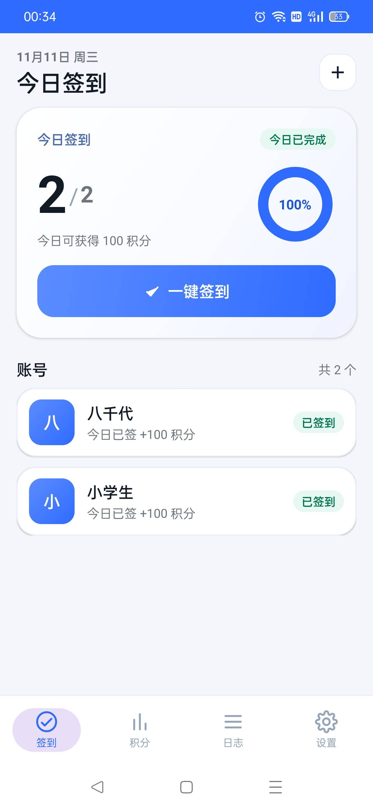
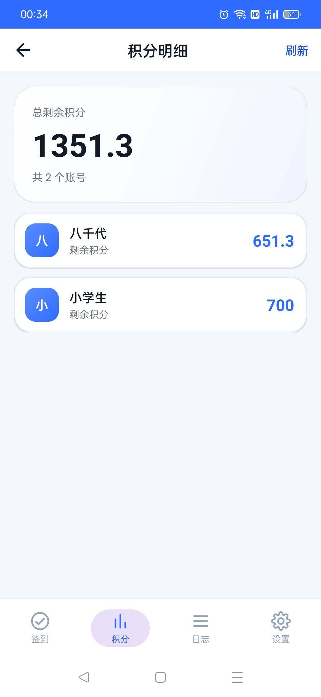
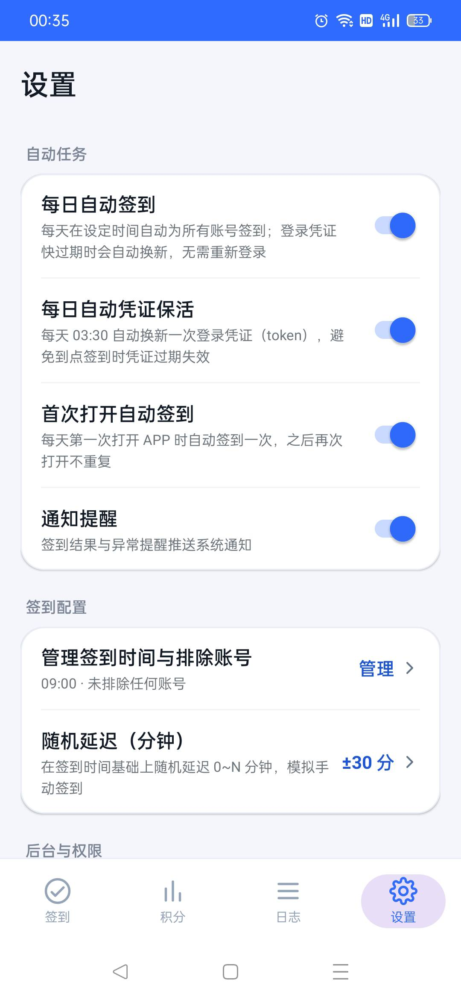
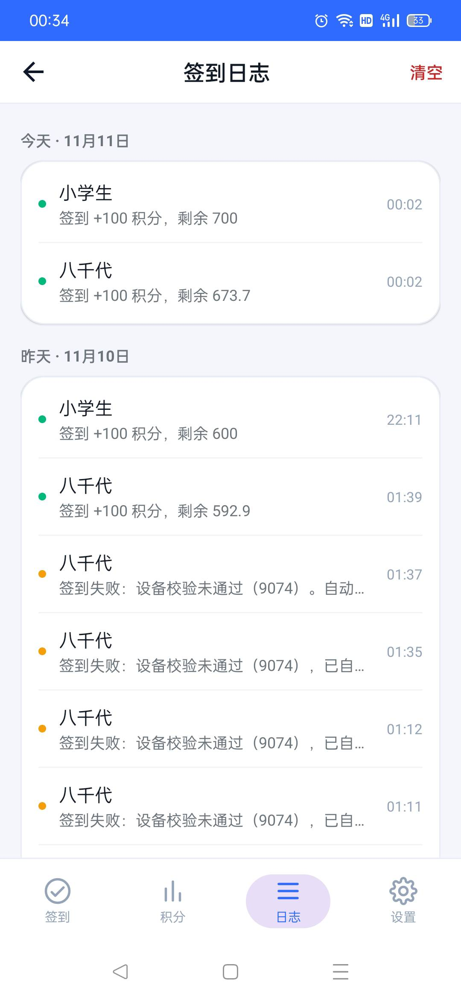

# Trae 签到助手（TraeCheckin）

> 手机上完成 Trae 每日签到积分的领取（额度以官方为准）：登录、一键签到、积分明细、签到日志、定时自动签到。
> 原生 Android 实现，零第三方依赖，凭据只保存在本机。


> **重要声明（请务必先读）**
>
> 1. 本项目为**独立开发的第三方辅助工具**，与字节跳动 / Trae 官方**无任何关联、未获授权**，
>    仅供学习研究使用；因使用本软件产生的一切后果由使用者自行承担。
> 2. **本项目有大量代码直接参考了原版开源项目
>    [`Luckyboy-daidai/wb-checkin-android`](https://github.com/Luckyboy-daidai/wb-checkin-android)**
>    ——包括设置页分组结构、界面配色、`Prefs` 静态方法 + `SharedPreferences` 的持久化写法、
>    开关状态回读逻辑，以及应用内文档与免责声明的框架。原项目版权行与 MIT 许可证全文已按
>    许可要求保留在 [`THIRD-PARTY-NOTICES.md`](THIRD-PARTY-NOTICES.md)。
> 3. **本项目代码主要由 AI 编写：hy4 与 DeepSeek V4.1 Flash**（Java 源码、XML 布局与资源、
>    构建脚本、文档文案）。人工负责需求、真机验证与发布；关键路径已经真机验证。
>    详见 [`AI-USAGE.md`](AI-USAGE.md)。
>
> 项目状态：本项目最初仅为个人自用，后来整理开源；受官方接口与维护精力所限，后续大概率不会有功能性更新，现有版本按「现状」提供，不承诺固定响应时限或持续可用。

<p align="center">
  
  
  
</p>

<p align="center"><sub>真机截图（1080×2340；账号名称为用户自设别名，积分为截图时余额）</sub></p>

## 下载安装

**最新版本 v2.4.2，安装即用。**

- [**下载 TraeCheckin-2.4.2.apk**](https://github.com/Liqevu324/trae-checkin-android/releases/latest)
- 要求 Android 7.0+（minSdk 24）。
- 可直接覆盖安装 v2.4.1 / 2.4.0 / 2.3.0 / 2.2.0：签名证书一致，账号、签到记录、
  手动设置的设备号与设置全部保留。
- 从源码自行构建的 APK 签名不同，需先卸载旧版（会清空本地数据）。
- 安装包 SHA256：`48a74c12d81bfa86e6e1f78b429cd256ee5a968ef3e7827f654dac24066e7e5d`
- 签名证书 SHA256：`6f53acbfb3dc6723db5239232a1b039d003e30387727844956c6061882b824b3`

```bash
sha256sum TraeCheckin-2.4.2.apk
apksigner verify --print-certs TraeCheckin-2.4.2.apk
```

更详细的校验值与签名信息见 [`docs/SHA256SUMS.txt`](docs/SHA256SUMS.txt) 与
[`docs/SIGNING-CERT.txt`](docs/SIGNING-CERT.txt)。

## 功能

- **添加账号**：内置 Trae 官方 SOLO OAuth 授权页，登录成功后自动回跳并读取凭证，无需电脑、无需手动复制 token
- **一键签到**：并发为全部账号领取当日积分，逐个账号实时刷新状态与进度环
- **多账号**：账号列表支持点击菜单（立即签到 / 查看积分 / 删除），长按快速删除
- **积分明细**：汇总所有账号的剩余积分，逐账号展示，支持手动刷新
- **签到日志**：按天分组展示签到记录，可一键清空；失败尝试也会记录并展示服务端原因；长按单条日志可复制完整报错与错误码（不含登录凭据）
- **每日定时签到**：系统闹钟（AlarmManager）到点自动签到，结果以通知汇报，重启后自动恢复
- **首次打开自动签到**：作为定时任务被系统杀掉时的兜底
- **每日凭证保活**：每天 03:30 自动换新一次登录凭证，避免到点签到时 token 过期
- **签到配置**：自定义签到时间、随机延迟（避免固定时间集中请求）、按账号排除自动签到
- **账号导入 / 导出**：JSON 文本迁移账号，导入只追加不覆盖；导出前会给出凭据安全提示
- **内置文档**：使用说明书、隐私协议、用户协议与免责声明、开源许可与致谢，设置页可直接查看
- **关于信息**：开发者、版本号、MIT 许可证与页脚免责声明
- **界面动效**：页面切换淡入位移、底部 Tab 淡紫选中胶囊、卡片浮入动画
- **原生界面**：纯系统控件 + XML 布局，无 androidx / Material / 任何第三方库

最低支持 Android 7.0（minSdk 24，targetSdk 34）。

<details>
<summary>签到日志截图（含 9074 排障示例）</summary>
<p align="center"></p>
</details>

## 权限说明

| 权限 | 用途 | 拒绝后果 |
|---|---|---|
| `INTERNET` | 访问 `api.trae.cn` 与 `www.trae.cn` | 无法登录与签到 |
| `POST_NOTIFICATIONS`（Android 13+） | 推送签到结果通知 | 签到照常执行，只是没有通知 |
| `RECEIVE_BOOT_COMPLETED` | 开机后重新注册定时闹钟 | 重启后需手动打开一次 App |
| `SCHEDULE_EXACT_ALARM` / `USE_EXACT_ALARM` | 到点精确触发签到 | 退化为系统批量唤醒，可能延迟 |
| `REQUEST_IGNORE_BATTERY_OPTIMIZATIONS` | 引导加入电池优化白名单 | OPPO / 小米 / 华为可能杀掉定时任务 |
| `WAKE_LOCK` | 签到过程中保持唤醒 | 息屏时可能签到到一半被挂起 |

国产 ROM（OPPO / vivo / 小米 / 华为）还需在系统设置里允许「自启动」，App 的设置页提供了跳转入口。

## 使用

1. 首次打开 → 点右上角「+」→ 在官方授权页用手机号 + 验证码登录 Trae
2. 登录成功后上游自动回跳，App 截住回调、换取凭证并**无需手动操作**返回，账号出现在列表中并自动完成当天签到
3. 之后可随时点「一键签到」；「设置」按分组提供自动任务、签到配置、后台权限、数据、帮助与协议
   - 自动任务：每日自动签到 / 凭证保活 / 首次打开自动签到 / 通知提醒
   - 签到配置：管理签到时间（默认 09:00）、随机延迟、勾选不参与自动签到的账号
   - 数据：导入 / 导出账号（JSON）、清除日志
   - 帮助与协议：四份内置文档，以及开发者、版本与免责声明
4. token 过期时 App 会自动用保存的 `refreshToken` 续期；若提示「需重新登录」，点开账号菜单选「重新登录」再授权一次即可
5. **从 2.2.0 及更早版本升级的用户：请把每个账号都重新登录一次。** 旧版本授权链接的
   `machine_id` / 请求头指纹与官方契约不一致，会让上游设备校验持续返回 `9074`
6. **若重新登录后仍报 `9074`**：点账号卡片 →「设置设备号」，手动指定一个 12~20 位纯数字的
   设备标识。**只需设置一次**，之后每天签到全程在手机完成，不需要电脑、也不需要服务器。
   请确认你的使用方式符合 Trae 官方服务条款；多个账号请分别使用各自的号码。

## 工作原理

> 完整的模块图、数据流、网络特征、错误码、已知限制与合规风险见
> [`ARCHITECTURE.md`](ARCHITECTURE.md)；本节为摘要。

### 登录：官方 SOLO OAuth（全程手机端，无需电脑）

网页版 `/login` + cookie 换短期 JWT 的旧链路会被签到接口判成「设备校验未通过」，稳定返回
`9074 当前参与用户太多，请稍后再试`（该提示与人数无关，实际是设备校验未通过）。官方桌面客户端走的是另一套
SOLO 谱系，本项目在手机 WebView 内复刻了它：

1. `LoginActivity` 生成 **12~20 位纯数字 `device_id`**（避开已有账号，一个设备号一天只能签一个账号），
   `machine_id` 为**独立的 32 位 hex**，`login_trace_id` 为 16 位 hex（仅用于回调比对），然后打开官方授权页
   `https://www.trae.cn/authorization`，把这些设备参数一并注册给上游。
   重新登录时若账号已有手动设置的设备号，会**原样沿用**，不会被随机生成的设备号覆盖。
2. 用户完成手机号 + 验证码登录后，上游回跳 `http://127.0.0.1:18080/authorize?...`。
   App 在 `shouldOverrideUrlLoading` / `onPageStarted` / `onReceivedError` 三处截住该 URL，
   **不会真的访问本地端口**，也就不需要电脑或任何本地服务。明文 loopback 由
   `res/xml/network_security_config.xml` 单独放行，其余域名仍强制 HTTPS。
3. 回调里的 `refreshToken` / `userJwt` / `userInfo` 解析后，调
   `POST https://api.trae.com.cn/cloudide/api/v3/trae/oauth/ExchangeToken` 换长期访问凭证，
   用**同一个设备号**调 `status` 校验，再把 `token / refreshToken / expiresAt / deviceId / machineId / uid`
   整份写入应用私有 `SharedPreferences`（`AccountStore`）。
4. 授权页仍是 React + Modern.js 的 SSR 输出，按钮交互依赖 bundle hydrate。项目**不修改页面 DOM、不写入用户数据**，
   唯一的 `HYDRATE_JS` 是只读探针；旧内核（Chrome/83）对 `8049.*.js` 的私有方法与 `??=` 会 SyntaxError，
   由 `downgradeJs()` 在 `shouldInterceptRequest` 里做只读语法兼容改写（内核 ≥ 84 时不介入）。

### 签到：对齐客户端请求契约

- `POST https://api.trae.cn/trae/api/v2/ug/checkin_credits/status` 查状态
- `POST https://api.trae.cn/trae/api/v2/ug/checkin_credits/claim` 领取积分
- `POST https://api.trae.cn/trae/api/v2/pay/ide_user_ent_usage` 查余额
- 请求体统一 `{"req_source":2}`（旧网页谱系的 `req_source=1` 会触发 9074）
- 请求头严格对齐官方 `ug_request` 最小集合：`Authorization: Cloud-IDE-JWT <token>`、
  `X-Device-Id`、`X-User-Region: CN`、`Content-Type`、`Accept`、`User-Agent: Trae/0.1.43`。
  **不额外发送** `x-device-brand` 等设备指纹头：授权链接声明的是 `PC/1.0`，
  再补一套 `Windows/10.0.22631` 会自相矛盾，被上游判为伪造指纹。
- 积分口径为服务端账本 `usage_summary.total_amount - consumed_amount`，即 Trae 客户端显示的可用余额

**错误码处理**：

| code | 含义 | 处理 |
|---|---|---|
| `0` | 领取请求被接受 | **回查 `status.checked_in`**，确认为 true 才记成功，避免 HTTP 200 假成功 |
| `1001` / HTTP 401 | 登录过期 | 用 `refreshToken` 换 token 后重试一次；旧账号回落到 cookie |
| `9004` | 设备未注册 | 提示重新登录完成设备绑定 |
| `9074` | 设备校验未通过 | 手动设备号**原样保留、不轮换**；自动号 24 小时内最多换一次重试；仍失败引导「设置设备号」 |
| `9095` | 当前设备今日已签到 | 终局失败，不重试（多账号必须分配不同设备号） |

> **9074 与登录无关**：用无效 token 实测上游 `claim` 一律返回 `1001`，不返回 `9074`；
> 而 `status` / `ide_user_ent_usage` 在 9074 时仍能正常读到余额。也就是说凭证是有效的，
> 9074 是上游对 `X-Device-Id` 的**独立设备校验**，反复重新登录并不能解决。

定时签到由 `AlarmManager` 触发 `CheckinReceiver`，执行完立即重排下一天。

凭据与记录不上传任何第三方服务器；`android:allowBackup="false"`，不参与系统云备份。

## 从源码构建

依赖：JDK 17+、Android SDK（`build-tools;34.0.0` 与 `platforms;android-34`）。

```bash
ANDROID_SDK=/opt/android-sdk bash build.sh
```

无 Gradle 的轻量构建链：`aapt2 compile/link → javac --release 8 → d8 → zip 塞入 classes.dex → zipalign → apksigner`。
签名凭据通过 `SIGNING_KEYSTORE` / `SIGNING_STORE_PASS` / `SIGNING_KEY_PASS` 环境变量提供，
脚本内不含明文口令；未配置时只生成一次性调试密钥，产物不可用于发布或覆盖安装。
**后续升级务必复用同一把私钥**，否则无法覆盖安装。

## 项目结构

```
trae-checkin-android/
├── .github/
│   ├── CODEOWNERS
│   ├── ISSUE_TEMPLATE/
│   │   ├── bug_report.yml
│   │   └── feature_request.yml
│   ├── PULL_REQUEST_TEMPLATE.md
│   └── workflows/build.yml        # CI：构建 + 签名校验
├── .gitattributes
├── .gitignore
├── AI-USAGE.md
├── ARCHITECTURE.md
├── CHANGELOG.md
├── CODE_OF_CONDUCT.md
├── CONTRIBUTING.md
├── LICENSE
├── PRIVACY.md
├── README.md
├── SECURITY.md
├── THIRD-PARTY-NOTICES.md
├── AndroidManifest.xml
├── build.sh                       # 无 Gradle 构建脚本
├── docs/
│   ├── RELEASE_NOTES_v2.4.2.md
│   ├── SHA256SUMS.txt
│   └── SIGNING-CERT.txt
├── res/
│   ├── layout/                    # 原生 XML 布局（主界面 / 登录 / 积分 / 日志 / 设置 / 文档 + 列表项）
│   ├── drawable/                  # 纯 shape / vector 资源
│   ├── mipmap-*/                  # 启动图标
│   ├── values/                    # colors / dimens / strings / themes（含设置页分组样式）
│   ├── anim/                      # 页面转场动画（淡入 + 轻微位移）
│   ├── raw/                       # 4 份中文文档（说明书 / 隐私 / 用户协议 / 开源许可）
│   └── xml/                       # network_security_config（只放行 loopback 回调）
├── screenshots/                   # 4 张真机截图
└── src/com/traecheckin/mobile/
    ├── MainActivity.java          # 账号列表 + Hero 卡 + 一键签到
    ├── LoginActivity.java         # SOLO OAuth 授权 + 回调截获 + 凭证落库 + JS 语法降级
    ├── CreditsActivity.java       # 积分明细
    ├── LogsActivity.java          # 签到日志（长按复制完整报错）
    ├── SettingsActivity.java      # 分组式设置 + 文档入口 + 导入导出 + 关于
    ├── DocsActivity.java          # 通用文档页（Spannable 渲染纯文本）
    ├── NavHelper.java             # 底部 Tab 统一高亮（淡紫胶囊）+ 切换动画
    ├── Anim.java                  # 轻量浮入动画工具
    ├── Notice.java                # 系统通知统一出口
    ├── AutoScheduler.java         # AlarmManager 定时调度（签到 + 凭证保活）
    ├── CheckinReceiver.java       # 定时签到执行 + 通知
    ├── MaintenanceReceiver.java   # 每日 03:30 凭证保活
    ├── BootReceiver.java          # 开机 / 更新后恢复闹钟
    ├── CheckinEngine.java         # 签到执行引擎（换号重试 / 回查确认）
    ├── CheckinResult.java         # 纯 Java 成功判据（便于真值表测试）
    ├── TraeApi.java               # SOLO 接口封装 + ExchangeToken
    ├── AccountStore.java          # 多账号 / 历史 / 设备号迁移 / 导入导出（SharedPreferences + JSON）
    ├── Prefs.java                 # 设置持久化（含新增开关与排除账号）
    └── App.java                   # 通知渠道
```

> `TraeCheckin.apk` 是 `build.sh` 的构建产物，不入库；正式安装包统一从
> [GitHub Releases](https://github.com/Liqevu324/trae-checkin-android/releases/latest) 下载。

## 已知限制

- **定时任务可能被 ROM 中断**：`CheckinReceiver` 采用「BroadcastReceiver + 裸线程 + WakeLock」执行签到，
  未走 JobScheduler/WorkManager（无第三方依赖的约束下成本较高）。国产 ROM 需手动允许「自启动 / 后台运行 /
  关闭电池优化」，否则到点签到可能被系统杀掉；App 会把设置页的权限引导作为兜底。
- **底部 Tab 切换是 Activity 级跳转**：四个 Tab 各自是独立 Activity，切换用 `startActivity + finish()`
  （不堆栈）。v2.4.0 起由主题 `PageAnimation` 提供统一的淡入 + 轻微位移转场（240ms），
  配合页面内容浮入与 Tab 胶囊缩放动画；无需引入 Fragment 即可获得顺滑观感。
- **上游对设备号有独立校验（9074 的根因）**：`device_id` 是 12~20 位纯数字、每个账号互不相同，
  并随授权页注册给上游。但上游还会校验该号是否「客户端真实注册、已被账号绑定」，
  手机端自动生成的号**可能不被认可** —— 这是上游风控，不是登录或网络问题。
  此时点账号卡片 →「设置设备号」手动指定设备标识即可
  （一次性操作，见「使用」第 6 条）。手动号会被标记为「手动设置」，9074 时**不会自动轮换**。
  一个设备号一天只能签一个账号，第二个账号用同号会返回 `9095`（保存时会检测撞号）。
- **`9004`（设备未注册）/ `9074`（设备校验未通过）**：账号仍会保存并显示具体原因，
  日志长按可复制完整报错，含 `device_id` / `device_src` / `req_source`，便于定位；
  日志**不含 token、refreshToken、cookie 或完整响应体**。
- **refreshToken 也可能失效**：用户在 Trae 侧退出登录、修改密码或长期不使用时，
  `ExchangeToken` 会被拒，此时账号标记「需重新登录」，重新授权一次即可。
- **导入 / 导出账号包含完整登录凭据**：导出的 JSON 等同于账号登录状态，
  App 在复制前会给出安全提示；请勿上传到公开仓库、网盘分享或聊天群。
  导入只追加账号、按 token / uid 去重，不会覆盖已有数据。
- **旧版 WebView 内核兼容性**：登录页是 React 应用，官方 JS 用到 ES2022 语法（私有方法、`??=`），
  需要 Chrome 84+。App 已内置自动语法降级（见「工作原理」第 1 条），Chrome 84 以下也能正常交互。
  但降级器是针对当前前端构建适配的，若官方换用其他新语法，降级会失效 —— 此时页面会退回
  「能看能输入、按钮点不动」的状态，App 会提示"网页脚本未能运行（WebView 内核 Chrome/x.y.z）"。
  遇到这种情况，可先到应用商店更新「Android System WebView」（治本），并**长按「重新发起登录」按钮**
  把诊断信息（含 `js_patch` 状态与报错位置）复制出来反馈给开发者。
- **第三方登录走 `window.open`**：抖音 / 苹果 / 企业账号登录会弹出授权页，App 用
  1×1 的隐藏 WebView 承接弹窗、并把首跳 URL 立刻转交主 WebView 展示；若某些机型上仍无法完成，
  建议使用手机号 + 验证码登录。
- **安全边界**：OAuth 回调校验、WebView Host 白名单、剪贴板导出、后台线程等已知限制见
  [SECURITY.md](SECURITY.md)。

## 版本线

| 版本 | versionCode | 核心变化 |
|---|---:|---|
| 1.0.0 | 1 | 初版：双 WebView + JSBridge + HTML 界面，完成多账号登录、`AccountStore`、`TraeApi`、JWT 别名解析、定时签到、签到历史、通知与免责声明 |
| 2.0.0 | 2 | 推倒重做：移除 WebView / JSBridge / HTML，改为纯 Java + XML 原生四 Tab（签到 / 积分 / 日志 / 设置）；新增 `Prefs`、`AutoScheduler`、42 个 drawable、5 档原生图标；`BootReceiver` 支持应用更新后恢复排程；APK 约 137 KB |
| 2.1.0 | 3 | 修复登录：改用官方 `/login`，移除 JSBridge 改 Cookie 探针换 token，修复添加账号黑屏、Chrome/83 的 ES2022 语法兼容、第三方登录弹窗、OPPO 通知权限与开关回弹 |
| 2.1.1 | 4 | 修复「假成功」：新增 `CheckinResult`，只有 `checked_in=true` 才记成功；失败尝试也写入历史 |
| 2.1.2 | 5 | 长按日志可复制完整报错（`app_version / account / time / result / code / remaining`），不再被省略号截断 |
| 2.2.0 | 6 | 登录链路改为官方 SOLO OAuth（`/authorization` + `RefreshToken → ExchangeToken`）；`device_id` 改为 12~20 位纯数字、`req_source=2`、积分改读服务端账本、`code=0` 后回查 `checked_in`，补齐 `9074 / 9095 / 1001` 处理 |
| 2.3.0 | 7 | 让纯手机签到真正跑通：去掉与授权页矛盾的 `x-device-brand=Windows` 等请求头、`machine_id` 改为独立 32 位 hex、新增「设置设备号」、手动设备号不轮换、`9074` 自动换号限频、日志增加 `device_id / device_src / req_source` 诊断字段 |
| 2.4.0 | 8 | 界面与设置大升级：5 组分组式设置、每日 03:30 凭证保活、积分到期提醒、排除账号、账号 JSON 导入导出、4 份内置中文文档、关于区、全局转场动画、配色对齐参考项目 |
| 2.4.1 | 9 | 开发者改为双署名；移除积分到期提醒（积分 30 天才过期，提醒意义不大）；补齐开源声明材料 |
| 2.4.2 | 10 | 开源前合规与文档修订：移除文档中的 `storage.json` 提取教程、移除与 MIT 冲突的「禁止商用」、补齐参考项目许可证列、语气中性化、换真机截图、整理为完整开源仓库；零业务逻辑改动，签名未轮换 |

> 1.0.0 / 2.0.0 据早期构建记录补充，未写入正式 `CHANGELOG.md`；2.1.0 起来自 `CHANGELOG.md`。
> 2.2.0 到 2.4.2 使用同一把签名私钥，可直接覆盖安装；1.0.0 / 2.0.0 / 2.1.x 的 APK 未保留。

主线：1.0 验证想法（WebView / HTML）→ 2.0 重写原生 → 2.1.x 修登录、假成功与日志 → 2.2.0 换官方 SOLO OAuth → 2.3.0 攻克 9074 → 2.4.0 做好界面与设置 → 2.4.1 / 2.4.2 精简与开源收尾。

## FAQ

**Q：支持哪些登录方式？**
A：取决于 Trae 官方授权页；建议使用手机号 + 验证码登录。

**Q：定时签到到点没执行？**
A：检查系统是否允许自启动、后台运行与电池优化白名单；被系统推迟的任务会在下次打开 App 时补签。

**Q：token 会过期吗？**
A：应用会自动用 `refreshToken` 续期；续期失败时账号会标记「需重新登录」，重新授权一次即可。

**Q：卸载会丢失什么？**
A：账号、签到日志与设置都保存在应用私有目录，卸载即全部清除。换机或卸载前请先导出账号。

**Q：支持多账号吗？**
A：支持个人多账号管理；不支持代签、批量注册、多租户或任何违反平台规则的用法。

**Q：为什么安装包只有约 200 KB？**
A：项目不使用 androidx / Material / 任何第三方库，纯 Android SDK 实现，所以 APK 很小。

## 免责声明

本项目为个人独立开发的**第三方工具**，与字节跳动 / Trae 及其关联方**无任何隶属、合作或授权关系**，
不是 Trae 官方客户端。本项目按「现状」提供，不提供任何明示或默示担保；因使用或无法使用本项目
造成的任何直接或间接损失，由使用者自行承担。

请遵守 Trae 的服务协议与当地法律法规：自动化操作可能带来账号风控、限流或封禁风险，请自行评估。
本项目仅操作使用者自己的账号，不提供批量 / 多租户 / 代签服务；
是否属于平台允许的使用方式，请以 Trae 官方服务条款为准；
**请勿用于批量账号、刷量或任何违反平台规则的行为**。

签到接口行为来自社区公开调研，不是 Trae 官方公开 API，可能随官方版本变更而部分或全部失效，
本项目不承诺持续可用或及时更新；积分政策（每日奖励额度等）以 Trae 官方为准。
如平台提出要求，本项目可随时停止分发。

本项目代码主要由 AI 生成，虽经真机验证，但不排除仍有错误；建议在使用前自行审阅源码。

> 说明：本项目采用 MIT 许可证，**MIT 允许商业使用**，因此此处不写「禁止商用」；
> 下面约束的是「未经授权的收费售卖 / 官方背书」，不是许可证限制。

## 分发说明

本应用仅通过 GitHub Releases 分发，**本人未授权任何个人或机构收费售卖**；从第三方付费购得的
版本均非开发者提供，其安全性无法保证，请只从官方 Release 渠道获取更新。
本应用未上架任何应用商店，不含广告、统计与推送 SDK。

## 关于代码来源与 AI 编写

- **原版项目**：[`Luckyboy-daidai/wb-checkin-android`](https://github.com/Luckyboy-daidai/wb-checkin-android)
  （MIT，Copyright (c) 2026 闪光男孩小志）。**本项目有许多代码直接参考了它**：界面结构与配色、
  设置页分组、卡片式开关行、`Prefs` 的静态方法 + `SharedPreferences` 写法与状态回读约束、
  应用内文档章节框架、免责声明与分发说明的措辞骨架。业务层 Java 类因技术栈不同
  （本项目零 Gradle / 零 AndroidX）由 AI 对照参考重新实现。
  版权行与 MIT 全文见 [`THIRD-PARTY-NOTICES.md`](THIRD-PARTY-NOTICES.md)。
- **AI 编写**：本项目代码主要由 **hy4** 与 **DeepSeek V4.1 Flash** 编写，
  详见 [`AI-USAGE.md`](AI-USAGE.md)。
- **引用链**：原版项目 → `changexbc/workbuddy-switch`（MIT，Copyright (c) 2026 wb-switch），
  本项目为间接参考；另参考了 `Maquer/trae-signin`、`xiaoyinge/trae-signin-gui`、
  `cowpy/TRAE-Automatic-sign-in` 的公开接口契约与错误码语义（未复制其代码）。
- **依赖库**：无第三方依赖，纯 Android SDK 原生实现，故无依赖许可证需要声明。

## 致谢

感谢原版项目 [`wb-checkin-android`](https://github.com/Luckyboy-daidai/wb-checkin-android)
提供的产品形态、界面组织与设置项参考，以及上述开源项目对登录链路、设备号形态、
`req_source=2` 与服务端账本口径的公开调研。所有第三方版权与许可证声明见
[`THIRD-PARTY-NOTICES.md`](THIRD-PARTY-NOTICES.md)。

## License

[MIT](LICENSE) © 2026 辉夜彩叶一休尼、我是八千代的狗

完整文档索引：[原理与架构](ARCHITECTURE.md) · [隐私说明](PRIVACY.md) ·
[第三方声明](THIRD-PARTY-NOTICES.md) · [AI 使用声明](AI-USAGE.md) ·
[安全政策](SECURITY.md) · [贡献指南](CONTRIBUTING.md) · [行为准则](CODE_OF_CONDUCT.md) ·
[更新日志](CHANGELOG.md) · [Release Notes](docs/RELEASE_NOTES_v2.4.2.md)
